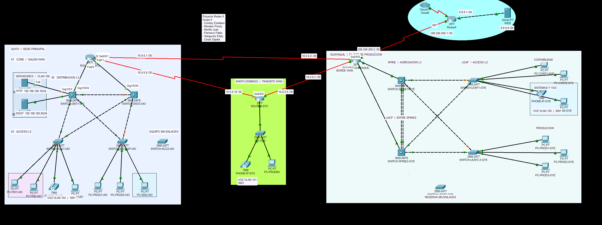
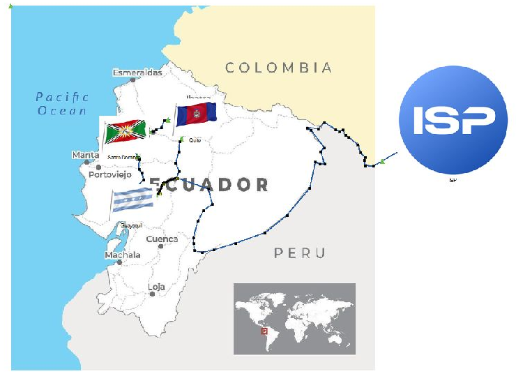
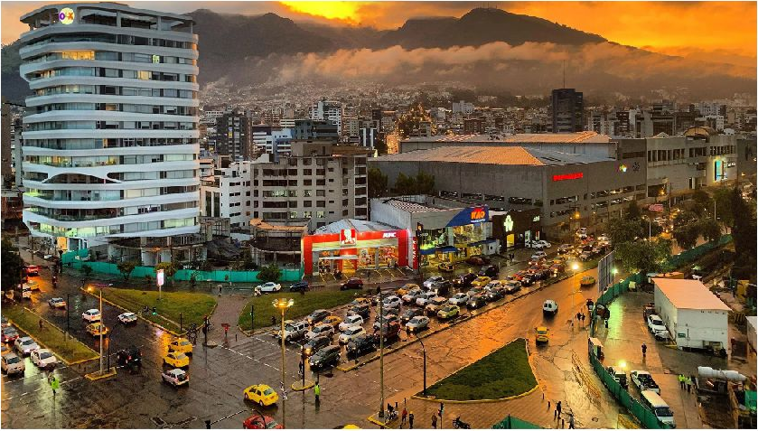
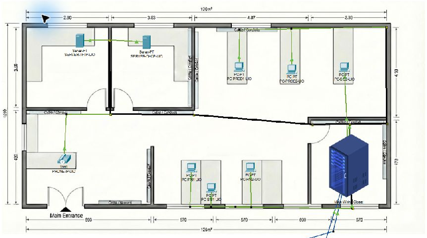
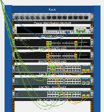
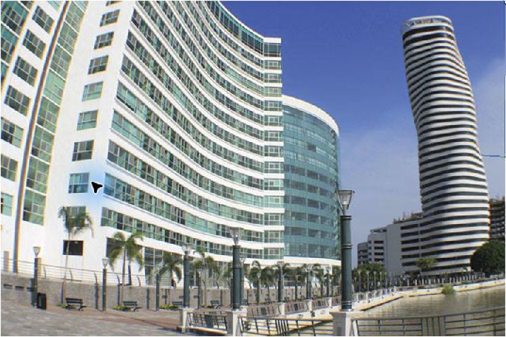
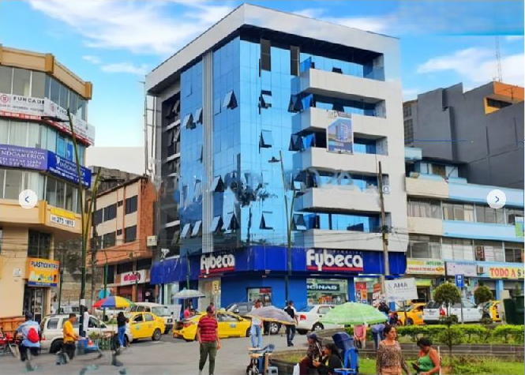
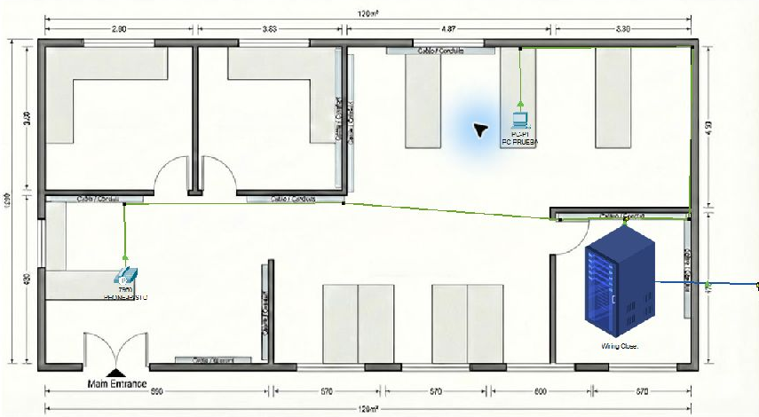
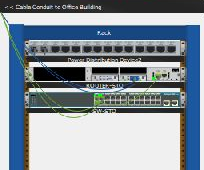

# Red convergente para Muebles Andinos

**Redes de Computadores II · Escuela Politécnica Nacional · Grupo 6**

Simulación de una red corporativa de **datos y voz** para tres sedes. Quito concentra los servicios centrales en una arquitectura de tres capas. Guayaquil organiza el acceso de la planta en una malla Spine–Leaf. Santo Domingo aloja telefonía y forma parte del camino alternativo de la WAN.

[Ver la topología](#topología) · [Leer el informe de diseño](docs/informe.md) · [Consultar el direccionamiento](docs/direccionamiento.md) · [Abrir la simulación](#simulación)

| Quito | Guayaquil | Santo Domingo |
| --- | --- | --- |
| Core WAN, distribución L3 y acceso L2 | Dos spines y dos leaves conectados en malla | Tránsito WAN y VLAN de voz |

## Topología

En Quito, el diagrama se lee de arriba hacia abajo, desde el router Core hasta los usuarios. Los servidores TFTP y DHCP aparecen junto a Distribución. En Guayaquil, la planta se lee de izquierda a derecha: borde WAN, columna Spine, columna Leaf y áreas usuarias. Los cuatro enlaces entre columnas muestran que cada leaf llega a ambos spines. El EtherChannel une **los dos spines**.

[Detalle de Quito](imagenes/quito.png) · [Detalle de Guayaquil](imagenes/guayaquil.png)

## Vista física

El mapa muestra los circuitos entre las tres sedes y la salida al ISP. Selecciona cualquier captura para abrirla a tamaño completo.

### Quito

En la sede principal, el plano sitúa los equipos de usuario, los servidores y el teléfono IP respecto al armario de comunicaciones.

| Entorno urbano | Plano de la oficina | Armario de comunicaciones |
| --- | --- | --- |
|  |  |  |

### Guayaquil

### Santo Domingo

El plano muestra el teléfono IP y la estación de la sede conectados al armario que aloja el router y el switch.

| Entorno urbano | Plano de la oficina | Armario de comunicaciones |
| --- | --- | --- |
|  |  |  |

## Diseño de red

- **WAN.** OSPFv2 en área 0 intercambia rutas entre sedes. La conexión Quito–Guayaquil tiene un camino alternativo por Santo Domingo.
- **LAN.** Las VLAN separan departamentos, voz y servidores. Los equipos multicapa hacen el enrutamiento entre VLAN y usan HSRP para ofrecer gateways virtuales.
- **Servicios.** DHCP, TFTP y telefonía IP dan soporte a las estaciones y a las tres extensiones del laboratorio.
- **Seguridad.** Las ACL controlan la salida de Producción hacia el ISP, protegen el TFTP de Quito y limitan el acceso desde la VLAN local de Santo Domingo.

## Simulación

Abre [ProyectoVFinal.pkt](ProyectoVFinal.pkt) en **Cisco Packet Tracer 8.2.2**. El archivo incluye el espacio lógico y el modelo físico.

Para clonar el archivo binario junto con la documentación, instala Git LFS y ejecuta `git lfs pull` dentro del repositorio.

**Grupo 6** · NetCore Solutions · Condoy Estéfano, Morales Presly, Murillo Juan, Pablo Pacheco, Sangucho Eddy y César Zapata
